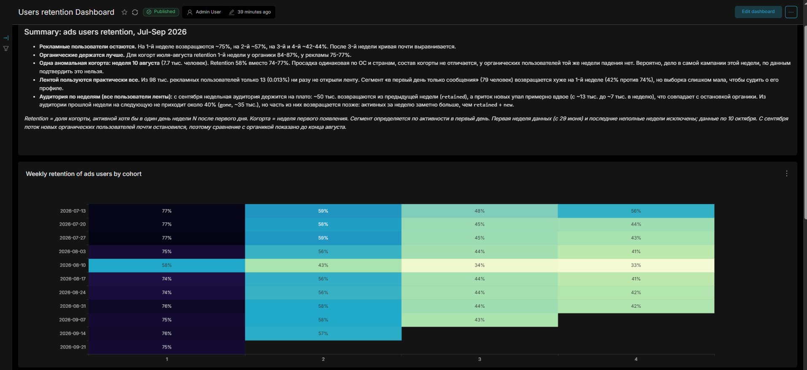
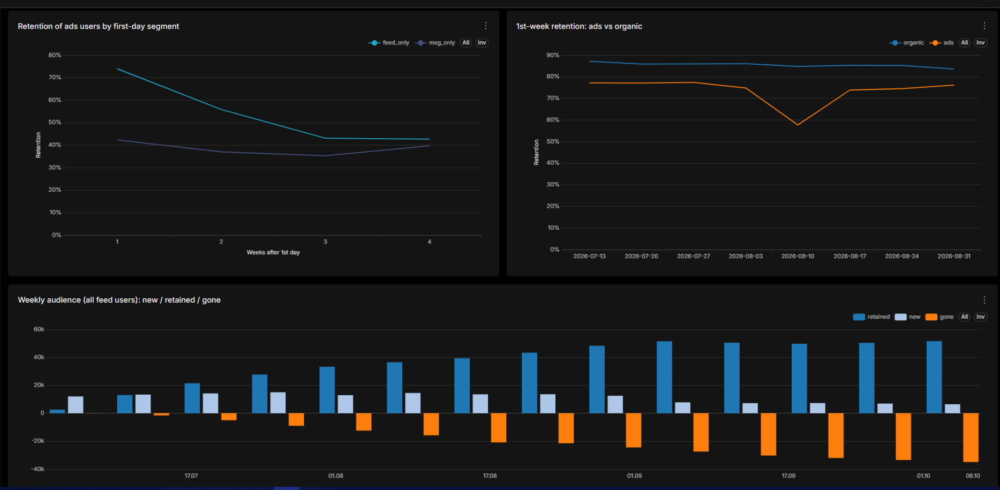

# Retention рекламных пользователей: дашборд в Apache Superset

Аналитический дашборд по данным учебного симулятора приложения с лентой новостей и мессенджером. Он отвечает на вопросы: что стало с пользователями, привлечёнными рекламной кампанией, как часто они продолжают пользоваться приложением, чем они отличаются от органических пользователей и кто из них не дошёл до ленты.

Это вторая часть проекта. Первая часть, дашборд про связь ленты и сообщений (DAU, портрет пользователя, переписка), описана в основном [README](README.md).





## Вопросы, на которые отвечает дашборд

- Как быстро рекламные пользователи уходят и на каком уровне удержание стабилизируется?
- Отличаются ли они от органических пользователей?
- Есть ли когорты, которые держатся заметно хуже остальных, и чем они отличаются?
- Какие пользователи не смогли воспользоваться лентой, и что их объединяет?
- Как меняется аудитория по неделям: сколько приходит новых, сколько остаётся и сколько уходит?

## Что внутри дашборда

4 графика и блок с выводами.

| График | Что показывает |
|---|---|
| Retention ads users by weeks | тепловая карта: когорты рекламных пользователей (неделя первого появления) по строкам, недели после первого дня по столбцам |
| Retention of ads users (1st day) | кривая retention для пользователей, которые в первый день пользовались только лентой (`feed_only`) или только сообщениями (`msg_only`) |
| 1st week Retention: organic / ads | retention 1-й недели по когортам отдельно для органических и рекламных пользователей |
| Weekly audience | новые (`new`), оставшиеся с прошлой недели (`retained`) и не пришедшие (`gone`, показаны вниз) среди всех пользователей ленты |

## Основные выводы (когорты июля-сентября 2026)

- **Рекламные пользователи остаются.** На 1-й неделе возвращаются около 75%, на 2-й около 57%, на 3-й и 4-й 42-44%. После 3-й недели кривая почти выравнивается.
- **Органические держатся лучше.** Для когорт июля и августа retention 1-й недели у органических 84-87%, у рекламных 75-77%.
- **Одна аномальная когорта: неделя 10 августа** (около 7.7 тыс. пользователей). Retention 1-й недели 58% вместо 74-77%. Просадка одинакова по ОС (Android и iOS), по странам и по возрасту и полу, состав когорты не отличается. У органических пользователей той же недели падения нет (85%). Вероятная причина кроется в самой кампании этой недели, по данным подтвердить это нельзя.
- **Лентой пользуются практически все.** Из примерно 98 тыс. рекламных пользователей только 13 (0.013%) ни разу не открыли ленту. Сегмент «в первый день только сообщения» (79 человек) возвращается хуже на 1-й неделе (около 42% против 74%), но к 4-й неделе значения сближаются (около 40% против 43%). Выборка слишком мала, чтобы судить о профиле этих людей: по возрасту и полу они не отличаются от остальных.
- **Аудитория по неделям** (все пользователи ленты): с сентября недельная аудитория выходит на плато. Около 50 тыс. человек остаются с предыдущей недели, приток новых снизился примерно вдвое (с 12-13 тыс. в июле до 6-7 тыс. в неделю), не приходит на следующую неделю около 30-35 тыс. человек.
- **Органический приток почти остановился в сентябре.** Размер органических когорт упал с примерно 5 тыс. до нескольких сотен, а затем до десятков человек, поэтому сравнение с органикой показано до конца августа.

## Как считаются метрики

- **Когорта**: неделя первого появления пользователя (по понедельнику). Первая активность считается по обеим таблицам, `feed_actions` и `message_actions`.
- **Retention недели N**: доля когорты, активной хотя бы в один день недели N после первого дня (`N = 0` это неделя первого дня, все активны). Недели считаются как `intDiv(дней с первого дня, 7)`.
- **Только полностью наблюдаемые недели**: если последний день недели N когорты позже последней даты в данных, ячейка не считается. Поэтому тепловая карта имеет вид треугольника, а у свежих когорт нет «ложного» спада.
- **Сегмент** (`feed_only`, `msg_only`, `both`) и **источник** (`ads`, `organic`) определяются по первому дню пользователя и затем не меняются. Поэтому сегмент `msg_only` по первому дню (79 человек) это не то же самое, что «ни разу не открыл ленту» (13 человек).
- **Метрика в Superset**: `SUM(users) * 1.0 / SUM(cohort_size)`, то есть отношение сумм, а не среднее готовых долей. Так малые срезы не перекашивают общий результат.
- **new / retained / gone** (Weekly audience): `new` это первая активность в ленте на этой неделе, `retained` это активные и на этой неделе, и на предыдущей, `gone` это активные на предыдущей неделе, но не на этой (показаны отрицательными). Активных за неделю больше, чем `new + retained`: часть пользователей возвращается после пропущенной недели.

## Данные

Источник: ClickHouse учебного симулятора, таблицы `feed_actions` и `message_actions`. Запросы выгрузки лежат в [`scripts/feed_messages.py`](scripts/feed_messages.py) (`q_retention`, `q_ads_profile`, `q_weekly`). Выгружаются **агрегаты** без идентификаторов пользователей:

- `data/retention.csv`: `cohort`, `week_life`, `source`, `segment`, `age_group`, `gender`, `os`, `country`, `cohort_size`, `users`. Страны сведены к пяти крупнейшим и `other`;
- `data/ads_profile.csv`: `segment`, `os`, `country`, `age_group`, `gender`, `users`, только рекламные пользователи, сегмент по всему периоду. В графики дашборда не входит: из него посчитан вывод, что только 13 из 98 тыс. рекламных пользователей ни разу не открыли ленту (`segment = 'msg_only'`).
- `data/weekly_audience.csv`: `metric` (`active`, `new`, `retained`, `gone`), `week`, `users`.

Данные по 10 октября 2026, выгрузка от 12 октября 2026. Дашборд использует когорты с 13 июля: данные начинаются в конце июня, и самые ранние когорты содержат пользователей, которые могли появиться раньше, чем началась выгрузка.

## Запуск

Нужен Docker (или GitHub Codespaces, где Docker уже есть).

1. Склонируйте репозиторий и откройте его в Codespaces или локально.
2. Запустите Superset и загрузите данные одной командой:
```bash
   bash deploy/init.sh
```
3. Откройте Superset и войдите: `admin` / `admin`.
   - Локально: http://127.0.0.1:8088/
   - В Codespaces: адрес порта 8088 на вкладке **Ports**.
4. Dashboards → иконка импорта → выберите `dashboard/dashboard_users_retention.zip`. Подключение и датасеты приходят вместе с архивом.
5. Откройте дашборд Users retention Dashboard.

## Ограничения

- **Связь, а не причина.** Сегмент определяется по первому дню. Пользователи, которые сразу зашли в ленту, могли быть более заинтересованными с самого начала, поэтому разница в retention не доказывает, что лента удерживает лучше.
- **Малые выборки.** Сегмент `msg_only` (79 человек) и сегмент `both` слишком малы для выводов по срезам, а органические когорты с сентября содержат десятки человек. Такие значения на графики не выносятся.
- **Причина просадки когорты 10 августа не установлена.** По доступным признакам (ОС, страна, возраст, пол, сегмент) когорта не отличается от остальных. Гипотеза про кампанию той недели не проверена.
- **Weekly audience строится по ленте** (`feed_actions`) и включает всех пользователей, а не только рекламных. Первые недели графика зависят от начала данных.
- Данные синтетические, это результаты учебного симулятора, а не реальных пользователей.
